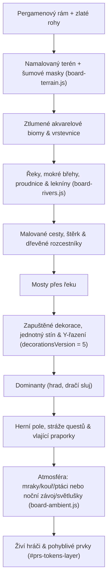

# KiDesky: Princeznino srdce — Architektura projektu

Dokument popisuje technickou architekturu webové hry **KiDesky: Princeznino srdce** (`https://www.ekobio.org/apps/KiDesky/`) po dokončení 6-etapového refaktoringu, modularizace a optimalizace.

---

## 1. Přehled projektu a provozní limity (ASPONE hosting)

Aplikace kombinuje čistý **klientský Vanilla JS / SVG / PWA stack** (bez bundleru a bez nutnosti build kroku) se **serverovým backendem v C# (.NET Framework / ASP.NET HTTP handlery `*.ashx`)** nad databází MSSQL.

### Tvrdá pravidla hostingu ASPONE
- **Zákaz `.exe` na FTP:** Na FTP serveru poskytovatele ASPONE je přísně zakázána přítomnost jakýchkoliv souborů s příponou `.exe` (včetně přejmenovaných záloh či CLI nástrojů typu `ffmpeg.exe` / `yt-dlp.exe`). Kontrolu vynucuje jak `tools/predeploy-check.js`, tak funkce `Assert-NoExePath` v `deploy_code_update.ps1`.
- **Kompilace za běhu přes IIS (bez lokálního `.dll`):** Handlery `api*.ashx` sdílejí společný základ `backend/KiDeskyCore.cs` (`KiDesky.Backend.KiDeskyHandlerBase`). IIS na produkci je kompiluje a spouští přímo za běhu; předkompilované `.exe` / `.dll` jsou vyloučeny v `.gitignore` a nenasazují se.
- **Dva FTP kořeny:** Hosting vyžaduje zrcadlovou synchronizaci souborů do obou cest: `/www/apps/KiDesky/` i `/www/wwwroot/apps/KiDesky/` (ošetřeno v `deploy_code_update.ps1`).
- **Tajné klíče mimo Git:** `appsettings.json` v repozitáři obsahuje pouze bezpečné zástupné hodnoty (`YOUR_*`). Produkční a lokální konfigurace (`appsettings.Production.json`, `appsettings.local.json`) jsou v `.gitignore`.

---

## 2. Mapa adresářové struktury a modulů

```text
KiDesky/
├── index.html                  # Aplikační shell, sekvenční <script defer> s ?v=... cache-bustingem
├── manifest.json               # PWA manifest
├── service-worker.js           # Offline/caching strategie (CACHE_NAME = kidesky-cache-v1.9.87)
├── web.config                  # IIS hlavičky, customErrors=RemoteOnly, skrytí backend/, MIME mapy
├── appsettings.json            # Šablona konfigurace (SQL, SMTP, Google OAuth, FTP, Gemini)
├── deploy_code_update.ps1      # FTP deploy s 64 KB streamingem, retry a před-deploy kontrolou
├── verify_live.ps1             # PowerShell wrapper pro tools/verify-live.js
├── test_board_validation.js    # Kořenový wrapper -> tools/tests/test-board-generator.js
├── ARCHITECTURE.md             # Tento dokument
│
├── api.ashx                    # Vstupní HTTP router (55 registrovaných akcí)
├── api-auth.ashx               # Autentizace (lokální + Google), registrace, profil, šatna (13 cest)
├── api-game.ashx               # Konfigurace, online místnosti, chat, emotes, telemetrie, vlastní mapy (12 cest)
├── api-media.ashx              # Správa videí, audia/hudby a oznámení (15 cest)
├── api-admin.ashx              # Administrátorské operace, uživatelé, šablony map a diagnostika (12 cest)
├── backend/
│   └── KiDeskyCore.cs          # Společná bázová třída KiDeskyHandlerBase, DB schéma, tokeny (~66.5 KB)
│
├── css/
│   ├── main.css                # Základní design systém, témata, layout (~40.4 KB)
│   ├── board.css               # Herní plán, SVG vrstvy, figurky, animace (~77.7 KB)
│   ├── mobile.css              # Responzivní layout a mobilní dock (~52.2 KB)
│   └── modals.css              # Dialogy, zbrojnice, boj, diplomy, editor (~93.1 KB)
│
├── js/
│   ├── core/
│   │   └── module-loader.js    # Lazy-loader skriptů/jazyků + WebP/flip normalizery (~7.4 KB)
│   ├── app-i18n.js             # i18n engine: detekce, t(), plural(), translateDOM(), syncUi() (~19.4 KB)
│   ├── i18n/
│   │   ├── languages.js        # Dynamický manifest jazyků PRS_I18N_LANGUAGES (~0.7 KB)
│   │   ├── cs.js / en.js       # Překladové slovníky (2 621 klíčů; ~197.4 KB / ~185.6 KB)
│   │   └── rules-cs.js / rules-en.js  # Lazy-loadovaný průvodce (11 kapitol + 6 pojmů; ~43.3 / ~37.1 KB)
│   ├── game-data.js            # Statická data: figurky, zbrojnice, nestvůry, draci, ctnosti (~114.9 KB)
│   ├── boards/
│   │   ├── boards-decor-catalog.js    # Katalog dekorací herního plánu (~30.6 KB)
│   │   ├── boards-geometry.js  # Geometrie uzlů, sousednosti, kolizí a BFS (~52.3 KB)
│   │   ├── boards-generator.js # Procedurální generátor království (~84.3 KB)
│   │   ├── boards-builder.js   # Stavební vrstva plánu, řek a mostů (~51.2 KB)
│   │   └── boards-presets.js   # Předdefinované mapy: classic_96, dragon_4598, compact_48 (~42.6 KB)
│   ├── engine/
│   │   ├── engine-state.js     # Inicializace partie, stav hráčů a scénáře (~45.3 KB)
│   │   ├── engine-movement.js  # Pohyb (pěšky, kůň, sokol), křižovatky a průchod STARTem (~39.9 KB)
│   │   ├── engine-economy.js   # Finance, panství, dobytek, daně, dluhové aukce (~31.6 KB)
│   │   └── engine-actions.js   # Herní akce, slavnosti, ctnosti, závěr partie (~36.4 KB)
│   ├── game-combat-ai.js       # Souboje (duely, nestvůry, draci) a AI boti (~87.1 KB)
│   ├── app-api.js              # Sjednocený HTTP/upload klient PRS_Api (~8.7 KB)
│   ├── app-modal-manager.js    # Centrální LIFO zásobník modalů a A11y správce (~17.1 KB)
│   ├── app-dialog.js           # Systémové modální potvrzení a toasty (KiDeskyDialog) (~23.9 KB)
│   ├── app-audio.js            # Web Audio / HTML5 hudební přehrávač a SFX (~27.4 KB)
│   ├── app-online.js           # Online multiplayer, WebSockets/polling, OAuth UI (~101.0 KB)
│   ├── app-saves.js            # Lokální a cloudové ukládání / export partií (~89.6 KB)
│   ├── app-musicwidget.js      # Plovoucí hudební widget (~13.3 KB)
│   ├── app.js                  # Hlavní aplikační kontroler PRS_App (~70.1 KB)
│   ├── app/
│   │   ├── app-landing.js      # Úvodní obrazovka a rychlý start (~42.0 KB)
│   │   ├── app-lobby-session.js# Sestavení hráčů, start partie, odhlášení/expirace (~43.1 KB)
│   │   ├── app-map-studio.js   # Výběr mapy, náhledy a konfigurace generátoru (~43.3 KB)
│   │   ├── app-music-ui.js     # Ovládání hudby v horní liště (~9.2 KB)
│   │   └── app-profile-cosmetics.js # Šatna figurek, profil a statistiky (~83.8 KB)
│   ├── board/
│   │   ├── board-camera.js     # Pan & zoom kamera SVG plánu (~23.4 KB)
│   │   ├── board-rivers.js     # SVG renderování řek a mostů (~75.5 KB)
│   │   ├── board-terrain.js    # Souvislý namalovaný terén se šumovými maskami (~11 KB)
│   │   ├── board-backdrop-cache.js # Offscreen Canvas bitmapová cache statického pozadí (~9 KB)
│   │   ├── board-static-svg.js # Statické SVG vrstvy polí, cest a krajiny (~86 KB)
│   │   ├── board-tokens.js     # Vykreslování figurek hráčů, draků a vlastnictví (~59.4 KB)
│   │   └── board-ambient.js    # Dekorativní částice a ambientní efekty (~8.2 KB)
│   ├── hud/
│   │   ├── hud-mobile-dock.js  # Dolní mobilní lišta a rychlé přepínače (~32.4 KB)
│   │   ├── hud-inspector.js    # Detail vybraného pole a přehled rytířů (~90.7 KB)
│   │   ├── hud-advisor.js      # Královský rádce – vyhodnocení tahu a doporučení (~62.0 KB)
│   │   ├── hud-action-panel.js # Hlavní panel akcí v tahu (~85.6 KB)
│   │   └── hud-turn-actions.js # Speciální tahy, pergamény a vyhodnocení (~45.5 KB)
│   ├── modals/
│   │   ├── modal-victory-diploma.js # Vítězný diplom a závěrečné statistiky (~33.6 KB)
│   │   ├── modal-armory.js     # Zbrojnice, nákup zbraní, šatů a elixírů (~27.3 KB)
│   │   ├── modal-combat.js     # Soubojové okno s kostkami a taktikou (~70.2 KB)
│   │   ├── modal-festival-chance.js # Slavnosti, turnaje a karty Náhody (~52.4 KB)
│   │   └── modal-cheatsheet.js # Přehledová nápověda / tahák pravidel (~41.6 KB)
│   ├── app-catalog.js          # Lazy-load: Katalog panství, bestiáře, trofejí (~73.5 KB)
│   ├── app-rules-guide.js      # Lazy-load: Interaktivní průvodce pravidly (~4.1 KB)
│   ├── app-admin.js            # Lazy-load: Admin panel (~96.9 KB)
│   └── app-map-editor.js       # Lazy-load: Vizuální editor map (~193.6 KB)
│
├── assets/
│   ├── web.config              # MIME mapy .webp a .mp4 pro složku assets
│   ├── audio/                  # Pouze .gitkeep v Gitu (lokální/FTP *.mp3 ignorovány)
│   └── ...                     # Optimalizovaná WebP grafika (castles, pawns, dragons, ...)
│
└── tools/
    ├── predeploy-check.js      # 8 před-deploy a integritních kontrol
    ├── test-backend-compile.js # Lokální csc.exe kompilace backend/*.cs + api*.ashx
    ├── test-api-security.js    # Bezpečnostní sondy proti produkčnímu API
    ├── test-auth-logout-autosave.js # Kontrola odhlášení a izolace autosave
    ├── test-etapa2-live.js / test-etapa3.js / test-etapa4.js / test-etapa4c.js / test-engine-smoke.js
    ├── test-etapa5-assets.js   # Kontrola WebP konverze, absence *_flip.* a SVG zrcadlení
    ├── test-etapa5b-media.js   # Kontrola audio/video velikostí a HTTP 200 na FTP/live
    ├── verify-live.js          # Základní live smoke check
    ├── optimize-assets-webp.py / optimize-media.py # Konverzní skripty médií (Python + ffmpeg/Pillow)
    └── tests/                  # Sjednocená regresní sada (Etapa 6)
        ├── run-all.js          # Centrální spouštěč 8 regresních sad (+ --live režim)
        ├── test-i18n.js        # Parita slovníků, HTML tagy v pravidlech, UI selecty, ratchet guard
        ├── test-board-generator.js # Validace 3 presetových a 8 procedurálních desek (BFS, kolize)
        ├── test-engine-simulation.js # 10 bezhlavých AI simulací + test determinismu
        └── test-api-contract.js # Smlouva FE PRS_Api <-> BE api.ashx, C# kompilace, web.config
```

---

## 3. Frontendová architektura a jádrové subsystémy

### 3.1 `PRS_ModuleLoader` (`js/core/module-loader.js`)
Spravuje dynamické načítání skriptů a verzování assetů:
- `getAssetVersion()` čte `?v=...` z vlastní `<script src>` značky a `resolveUrl(relPath)` stejnou verzi připojuje k lazy modulům.
- `loadScript(relPath)` deduplikuje souběžné požadavky přes interní `_cache`, kontroluje již načtené skripty (`[data-loaded="true"]`) a načítá s `async = false`.
- Bundly spouštěné na vyžádání:
  - `ensureLanguage(lang)` a `ensureRulesLanguage(lang)` – stahují jazykový slovník nebo pravidla podle metadat z `window.PRS_I18N_LANGUAGES`.
  - `ensureRulesBundle(lang)` – načte `js/app-catalog.js`, pravidla a následně `js/app-rules-guide.js`.
  - `ensureAdminBundle()` – načte `js/app-admin.js` pouze pro administrátory.
  - `ensureMapEditor()` – načte `js/app-map-editor.js` (~193.6 KB) až po otevření editoru map.
- Normalizace assetů: funkce `normalizeAssetUrl(url)` a `isFlippedAssetUrl(url)` (exportované i globálně jako `window.PRS_normalizeAssetUrl` a `window.PRS_isFlippedAssetUrl`) převádějí starší cesty (`.png` / `.jpg` / `*_flip.*`) ze starých savů nebo databáze automaticky na aktuální `.webp` bez `_flip`.

### 3.2 `PRS_Api` (`js/app-api.js`)
Jediný komunikační bod frontendu se serverem `api.ashx`:
- Veřejné metody: `get(action, params, options)`, `post(action, body, options)`, `upload(action, formData, options)` (přes `XMLHttpRequest` s podporou `onProgress`), `request(action, options)` a `buildUrl(action, params)`.
- Správa tokenu (`TOKEN_KEY = 'prs_auth_token'`): `getAuthToken()`, `setAuthToken()`, `clearAuthToken()`. Token posílá v hlavičce `X-KiDesky-Auth` (ignoruje hodnotu `'local'` používanou pro offline režim).
- Časové limity a chyby: standardní `request()` používá `AbortController` s výchozím limitem `timeoutMs = 20000` (20 s) a sjednoceným JSON parserem.
- Centrální `401` expirace relace: pokud backend vrátí HTTP `401` (a nejde o `silentAuth: true` nebo o akci z `AUTH_EXEMPT_ACTIONS`: `login`, `register`, `google-login`, `confirm-email`, `logout`), automaticky se zavolá `PRS_App.handleSessionExpired()`, která bezpečně vyčistí stav přihlášeného uživatele a zabrání míchání offline/cizího autosave.

### 3.3 `PRS_ModalManager` (`js/app-modal-manager.js`)
Řídí všechny `.modal-backdrop` dialogy v aplikaci (LIFO zásobník):
- Mapuje 30 registrovaných ID modalů v `CLOSE_METHOD_MAP` na konkrétní zavírací funkce a umožňuje dopisovat vlastní handlery přes `registerCloseHandler(modalId, fn)`.
- Sleduje DOM přes `MutationObserver` (`_observeMutations()`) a automaticky udržuje:
  - pořadí zobrazení (`z-index`),
  - třídu `body.modal-open` (blokování scrollu pozadí),
  - A11y atributy (`role="dialog"`, `aria-modal="true"`, `aria-labelledby`),
  - focus trap (`Tab` / `Shift+Tab` zůstává v aktivním modalu) a obnovení fokusu na původní prvek po zavření,
  - zavření klávesou `Escape` (prioritu má systémový `KiDeskyDialog` v `#kd-dialog-root`, teprve pak vrchní modal zásobníku).

### 3.4 `PRS_I18n` (`js/app-i18n.js` & `js/i18n/languages.js`)
- `DEFAULT_LANG = 'cs'`, preference se ukládá do `localStorage` pod klíčem `prs_lang`; při první návštěvě se zkusí detekce z `navigator.language`.
- **Dynamický registr:** `getAvailableLanguages()` spojuje `window.PRS_I18N_LANGUAGES` a `meta` hlavičky ze všech načtených slovníků v `window.PRS_I18N`.
- **Okamžité překreslení a ochrana proti race-condition:** `setLanguage(lang)` zvyšuje interní čítač `_switchSeq`; po případném dočtení slovníku a pravidel přes `PRS_ModuleLoader` aplikuje jen nejnovější požadavek. `_applyLanguage()` volá `translateDOM()`, `syncUi()` (naplnění a synchronizace všech `.prs-lang-select` včetně kompaktního `#mobile-dock-lang-select`), překreslí otevřené Map Studio / Map Editor / `PRS_HUD.render()`, spustí registrované callbacky `onLanguageChanged` a vyšle událost `prs:lang-change`.
- **Překladové API:** `t(key, params, fallback)` (s automatickým fallbackem na `cs` a interpolací `{param}`), `plural(count, forms)` (`one`/`few`/`many` pro `cs`, `one`/`other` pro ostatní), a atributový překlad v HTML (`data-i18n`, `data-i18n-html`, `data-i18n-title`, `data-i18n-placeholder`, `data-i18n-aria`, plus `app.page_title` pro `<title>`).

### 3.5 Vrstvy herní plochy (Board Rendering Pipeline)
Plán hry (`1400×860`) je skládán deterministicky v `#prs-board-stage` (`board-static-svg.js`, `board-terrain.js`, `board-rivers.js`, `board-ambient.js`, `board-tokens.js`):



- **Fingerprint cache `<defs>` (`_lastDefsKey`):** V `renderBoardSVG()` se `<defs>` přestavují pouze při změně motivu, denní/noční varianty, kvality grafiky nebo seedu mapy – ne při každém tahu figurky.
- **Jednorázová bitmapová cache statického pozadí (`board-backdrop-cache.js`):** Na mobilech (`data-device="mobile"`, všechny úrovně) se statické pozadí (`#prs-static-backdrop`: pergamen, terén, biomy, řeky, mosty, cesty, rozcestníky, dominanty a dekorace) jednorázově „upeče“ přes skrytý `<canvas>` do WebP/PNG `blob:` bitmapy (`inlineSvgImageHrefs()`, `--board-filter`, rozlišení `low = 1.0×`, `medium = 1.5×`, `high = 2.0×`) a nahradí stovky SVG elementů jediným `<image id="prs-baked-backdrop-img"/>`. Klikání na dekorace řeší `handleBakedBackdropClick()`, úklid `disposeBackdropCache()` (`URL.revokeObjectURL()`). Na **desktopu a tabletu** (`low`, `medium` i `high` přes `isDesktopHighCrispMode()`) zůstává plně ostrý nativní vektorový SVG (`#prs-board-stage`) bez pečení a bez CSS škálování bitmapy.
- **Hybridní kamera (`board-camera.js`, `board-ambient.js`, `css/board.css`):** Na mobilech (`data-device="mobile"`) aplikuje posun/zoom GPU vrstvu `translate3d(...) scale(...)` přímo na `#prs-board-svg` (`transform-origin: 0 0; will-change: transform`) koaleskovanou přes `requestAnimationFrame` (`scheduleViewportTransform()`) s mezipamětí rozměrů (`_measureBoardSize()`). Na **desktopu/tabletu** (všechny úrovně kvality) transformuje přímo `<g id="prs-board-stage">` v nativním rozlišení (políčka i popisky jsou trvale ostré bez doostřování při hoveru). Při `is-panning` / `is-interacting` (včetně dotykových gest `touchstart`/`touchend`/`touchcancel`) se pauzují CSS animace, ambientní `#prs-ambient-canvas` (vypnutý na `low`, `medium`, `data-device="mobile"` i při `prefers-reduced-motion`) i mobilní `backdrop-filter`.
- **Úrovně kvality grafiky (`localStorage.kidesky_graphics_quality`):**
  - `low`: klasický pergamenový podklad bez `board-terrain` textur, s **0** SVG `filter` / `drop-shadow` efekty ve statické vrstvě a řekách, zredukovanou vedlejší vegetací/detaily břehů, bez mobilního `backdrop-filter` a bez animací (maximálně plynulé na starších mobilech).
  - `medium` (výchozí na mobilech `< 768 px` nebo `<= 4` CPU vláknech): texturovaný terén přes vektorový `clip-path="url(#terrainInnerClip)"` a přímé vzory bez SVG `<filter>` a `<mask>` (`0` SVG filtrů/masek v celé desce i dekoracích), řeky a noční atmosféra bez `#prs-ambient-canvas` a bez souvislých animací mraků/kouře/ptáků.
  - `high` (výchozí na desktopu): kompletní živý svět včetně barevné harmonizace a všech animací (`glowFilter` pouze pro hlavní uzly `START`, `CASTLE`, `FESTIVAL`; respektuje `prefers-reduced-motion`).

---

## 4. Backendová architektura (`backend/` a `api*.ashx`)

### 4.1 Front-controller a doménové handlery
Veškeré HTTP volání směřuje na **`api.ashx`** (`KiDeskyApiHandler : KiDeskyHandlerBase`). Ten neimplementuje obchodní logiku přímo, ale podle parametru `?action=...` deleguje požadavek v `_actionRoutes` přes `BuildManager.CreateInstanceFromVirtualPath(targetPath, typeof(IHttpHandler))`:
- **`api-auth.ashx`** (13 akcí): `register`, `confirm-email`, `resend-confirmation`, `google-login`, `login`, `session-me`, `logout`, `update-profile`, `update_nickname`, `save-user-pawn`, `unlock-pawn`, `award-credits`, `record-game-stats`. Google přihlášení ověřuje ID token serverově vůči `oauth2.googleapis.com/tokeninfo?id_token=...`.
- **`api-game.ashx`** (12 akcí): `get-config`, `save-config`, `save-session`, `list-sessions`, `check-session`, `load-session`, `log-telemetry`, `send-emote`, `send-chat`, `get-chat`, `list-board-templates`, `get-board-template`.
- **`api-media.ashx`** (15 akcí): videa, audio a oznámení (`list-videos`, `hero-video`, `like-video`, `upload-video`, `admin-upload-video`, `admin-save-video`, `admin-delete-video`, `admin-set-hero-video`, `list-audio`, `upload-audio`, `admin-upload-audio`, `admin-save-audio`, `admin-delete-audio`, `get-announcement`, `admin-save-announcement`).
- **`api-admin.ashx`** (12 akcí): `admin-stats`, `admin-list-users`, `admin-update-user`, `admin-reset-password`, `admin-delete-user`, `admin-list-sessions`, `admin-close-session`, `admin-purge-sessions`, `admin-system-info`, `admin-save-board-template`, `admin-rename-board-template`, `admin-delete-board-template`.
- **`api.ashx` přímo** (3 cesty v kontraktu): `hello`, `status`, `default` (`HandleStatus`) -> celkem **55 registrovaných akcí**.

### 4.2 `KiDeskyHandlerBase` (`backend/KiDeskyCore.cs`)
Sdílená abstraktní bázová třída pro router i všechny subhandlery:
- **`ProcessRequest(HttpContext)`:** Při prvním průchodu (`KiDesky.EnvelopeApplied`) nastaví UTF-8 JSON obálku, CORS hlavičky přes whitelist `IsAllowedOrigin()`, obslouží `OPTIONS` preflight, zajistí DB schéma (`EnsureDatabaseSchema()`), zavolá abstraktní `DispatchAction(context, action)` a neošetřené výjimky zachytí do `500` JSON odpovědi s korelačním `errorId` zapsaným do `Trace.TraceError`. Při vnořeném delegování z `api.ashx` přeskočí opětovné obalení hlaviček a zavolá rovnou `DispatchAction()`.
- **Autentizace a autorizace:** Session tokeny se ukládají jako SHA-256 hash (`ComputeSha256Hex`); pomocné metody `GetAuthenticatedUser()`, `RequireAuthenticatedUser()`, `RequireAdmin()`, `CreateSessionToken()`, `RevokeSessionToken()`, `RevokeAllUserSessions()`.
- **Autoritativní ceník:** `_authoritativePawnPrices` drží na serveru závazné ceny figurek v kreditech (`0` pro základní/boty, `500–1000` pro prémiové s aurou), takže klient nemůže podvrhnout cenu nákupu.
- **Konfigurace (`GetSettingStr`, `GetSettingInt`, `GetSettingBool`):** Čte nastavení v pořadí `appsettings.Production.json` → `appsettings.local.json` → `appsettings.json` → proměnné prostředí, přičemž automaticky přeskakuje placeholdery začínající `YOUR_`. Vlastnost `CONN_STR` čte connection string nejprve z `Web.config`, poté ze JSON souborů (`ProductionConnection` / `DefaultConnection`) a nakonec z proměnných `SQL_CONN_STR` / `DB_CONN_STR`.

### 4.3 `web.config` a zabezpečení IIS
- `<hiddenSegments><add segment="backend" /></hiddenSegments>` zakazuje přímé stažení zdrojového kódu `backend/KiDeskyCore.cs`.
- `<customErrors mode="RemoteOnly" />` skrývá vzdáleným klientům stack trace ASP.NET.
- `httpRuntime maxRequestLength="524288"` (512 MB limit požadavku pro mediální uploady).
- Bezpečnostní hlavičky: `X-Content-Type-Options: nosniff`, `X-Frame-Options: SAMEORIGIN`, `Referrer-Policy: strict-origin-when-cross-origin`, `Cross-Origin-Opener-Policy: same-origin-allow-popups` (umožňuje vyskakovací okno Google OAuth).
- Explicitní MIME mapování pro `.json`, `.webmanifest`, `.webp`, `.mp4`, `.webm`, `.mp3`, `.ogg`, `.m4a` (doplněné i v `assets/web.config`).

---

## 5. Optimalizace assetů, médií a Service Worker cache

- **Grafika v WebP + SVG/CSS zrcadlení:** Herní obrázky byly zkonvertovány do `.webp` (`tools/optimize-assets-webp.py`) a duplicitní soubory `*_flip.*` byly zrušeny. Zrcadlení doleva/doprava provádí nativní SVG transformace `scale(-1, 1)` nebo CSS třída `.is-flipped`. Zpětnou kompatibilitu u starších URL zajišťuje `PRS_normalizeAssetUrl()`.
- **Média mimo Git:** Audio stopy (`assets/audio/*.mp3`, 128 kbps CBR) i videa (`*.mp4`, např. `ps_intro_04.mp4` v 720p H.264 CRF 26) jsou v `.gitignore` vyloučeny pomocí pravidel `*.mp3` a `*.mp4` (složku `assets/audio/` udržuje `.gitkeep`), aby se nenafukovala historie repozitáře.
- **PWA Service Worker (`service-worker.js`):**
  - `CACHE_NAME` (aktuálně `kidesky-cache-v1.9.87`) se při změně kódu navyšuje společně s `?v=...` u všech stylů/skriptů v `index.html` (kontroluje `predeploy-check.js`).
  - `install` přednačte `CORE_ASSETS` a volá `self.skipWaiting()`; `activate` smaže staré verze cache a převezme klienty (`clients.claim()`).
  - **Fetch strategie:**
    - *Bypass (vždy síť):* non-GET požadavky, cizí domény, `api.ashx`, `/api/`, `Range` hlavičky, `/assets/audio/`, `/assets/video/` a přípony `.mp3`, `.wav`, `.ogg`, `.m4a`, `.mp4`, `.webm`.
    - *Stale-While-Revalidate:* obrázky (`.webp`, `.png`, `.jpg`, `.jpeg`, `.svg`, `.gif`, `.ico`).
    - *Network-First (`cache: 'no-cache'`):* HTML navigace, `.js`, `.css`, `.json`.

---

## 6. Průvodce: Jak přidat nový jazyk za 15 minut

Díky manifestu `js/i18n/languages.js` a automatické synchronizaci prvků `<select class="prs-lang-select">` nevyžaduje nový jazyk žádné zásahy do `index.html` ani do herní logiky.

1. **Vytvořit hlavní slovník (`js/i18n/<kod>.js`):**
   - Zkopírujte `js/i18n/en.js` do `js/i18n/<kod>.js` (např. `de.js`).
   - Změňte hlavičku souboru na `window.PRS_I18N.<kod> = { ... }` a upravte sekci `meta`:
     ```json
     "meta": { "code": "de", "name": "Deutsch", "flag": "🇩🇪", "short": "DE" }
     ```
   - Přeložte všechny hodnoty při zachování přesné struktury všech klíčů (včetně `{param}` placeholderů a případných HTML značek).
2. **Vytvořit pravidla a slovníček pojmů (`js/i18n/rules-<kod>.js`):**
   - Zkopírujte `js/i18n/rules-en.js` do `js/i18n/rules-<kod>.js`.
   - Definujte `window.PRS_I18N_RULES.<kod> = { guide: [...], glossary: [...] }` se všemi 11 kapitolami (`id`, `title`, `body`) a 6 kartami slovníčku. Zachovejte validní, vyvážené HTML tagy uvnitř `body`.
3. **Zaregistrovat jazyk v manifestu (`js/i18n/languages.js`):**
   - Přidejte záznam do pole `window.PRS_I18N_LANGUAGES`:
     ```js
     {
       code: 'de',
       name: 'Deutsch',
       flag: '🇩🇪',
       short: 'DE',
       file: 'js/i18n/de.js',
       rulesFile: 'js/i18n/rules-de.js'
     }
     ```
   - *(Volitelné pro speciální plurály)* Pokud má jazyk jiná pravidla množného čísla než `one`/`other` (výchozí mimo `cs`), doplňte větev do `PRS_I18n.plural()` v `js/app-i18n.js`.
4. **Spustit automatickou validaci i18n:**
   - Příkaz `node tools/tests/test-i18n.js` ověří registraci v manifestu, 100% shodu všech klíčů s `cs.js`, absenci prázdných překladů, vyváženost HTML tagů v `rules-<kod>.js` a shodu `data-i18n*` atributů v `index.html`.
5. **Nasazení:**
   - Navyšte `?v=...` v `index.html` a `CACHE_NAME` v `service-worker.js`, poté ověřte celý balík testů (`node tools/tests/run-all.js --live`).

---

## 7. Testování a nasazování

### 7.1 Jednotná regresní sada (`tools/tests/`)
Spouštění všech 8 hlavních sad najednou:
```powershell
# Lokální regresní sada (bez přístupu na produkční server)
node tools/tests/run-all.js

# Kompletní sada včetně live kontrol proti https://www.ekobio.org/apps/KiDesky/
node tools/tests/run-all.js --live
```

Jednotlivé sady v `run-all.js`:
1. `tools/predeploy-check.js` – 8 kontrol: 1. zákaz `.exe` souborů, 2. validace JS syntaxe (`node -c`), 3. kontrola kódování UTF-8, 4. kontrola i18n slovníků (`cs`, `en`, parita 2 682 klíčů), 5. konzistence cache-bustingu (`CACHE_NAME`, `?v=`), 6. kolize metod na `window.PRS_App`, 7. bezpečnost tajných souborů v Gitu, 8. kompilace C# backendu přes `csc.exe`.
2. `tools/tests/test-i18n.js` – parita klíčů `cs`/`en` (2 682 klíčů), pravidla + glosář, všechny `data-i18n*` v `index.html`, dynamické `.prs-lang-select` prvky a ratchet limit pro přímé větvení `getLanguage() ===`.
3. `tools/tests/test-board-generator.js` *(spouštěn i přes `node test_board_validation.js`)* – validace 3 vestavěných map (`classic_96`, `dragon_4598`, `compact_48`) a 8 procedurálních desek (`dual`, `delta`, `single`, `none`): hranice mapy, 100% BFS dosažitelnost ze `START`, minimální rozestup uzlů, řeky/mosty, `.webp` landmarky a katalog dekorací.
4. `tools/tests/test-engine-simulation.js` – 10 bezhlavých AI-vs-AI herních simulací v izolovaném VM (`classic`, `slayer`, `tycoon`, `sprint` s boty `Bot_Balanced`, `Bot_Aggressive`, `Bot_Breeder`, `Bot_Noble`), kontrola herních invariantů a test determinismu seedovaného PRNG.
5. `tools/tests/test-api-contract.js` – lokální kompilace C# backendu přes `tools/test-backend-compile.js`, kontrola shody všech volání `PRS_Api.*` vůči routám `api.ashx`, ověření `web.config` a `api-auth.ashx`; v `--live` režimu navazuje na `tools/test-api-security.js` a `tools/test-etapa4c.js --live`.
6. `tools/test-auth-logout-autosave.js` – ověřuje bezpečnost odhlášení a izolaci autosave slotů.
7. `tools/test-etapa5-assets.js` – kontrola WebP assetů, absence `*_flip.*` a funkčnosti `PRS_normalizeAssetUrl()`; v `--live` režimu kontroluje nasazené `.webp` soubory po HTTP.
8. `tools/test-etapa5b-media.js` – kontrola audio/video souborů a v `--live` režimu dostupnost produkčních médií přes HTTP.

Doplňkové skripty pro cílenou diagnostiku v `tools/`: `test-etapa2-live.js`, `test-etapa3.js`, `test-etapa4.js`, `test-engine-smoke.js`, `verify-live.js` (a `verify_live.ps1`).

### 7.2 Postup nasazení na FTP ASPONE
```powershell
# Náhled změn bez zápisu (spustí predeploy-check a vypíše plán uploadu)
powershell -ExecutionPolicy Bypass -File .\deploy_code_update.ps1 -DryRun

# Standardní nasazení kódu (HTML, CSS, JS, C# handlery, konfigurace)
powershell -ExecutionPolicy Bypass -File .\deploy_code_update.ps1

# Nasazení včetně grafických assetů a audia/videa
powershell -ExecutionPolicy Bypass -File .\deploy_code_update.ps1 -AllAssets -IncludeMedia
```
Skript automaticky před nahráním spustí `tools/predeploy-check.js`, odmítne jakýkoliv `.exe` soubor (`Assert-NoExePath`), čte FTP přihlašovací údaje z `appsettings.Production.json` / `appsettings.local.json` a soubory nahraje v 64 KB blocích se 600s timeoutem a 3 pokusy do `/www/apps/KiDesky/` i `/www/wwwroot/apps/KiDesky/`.
